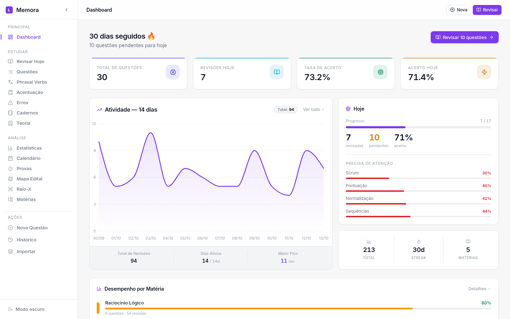
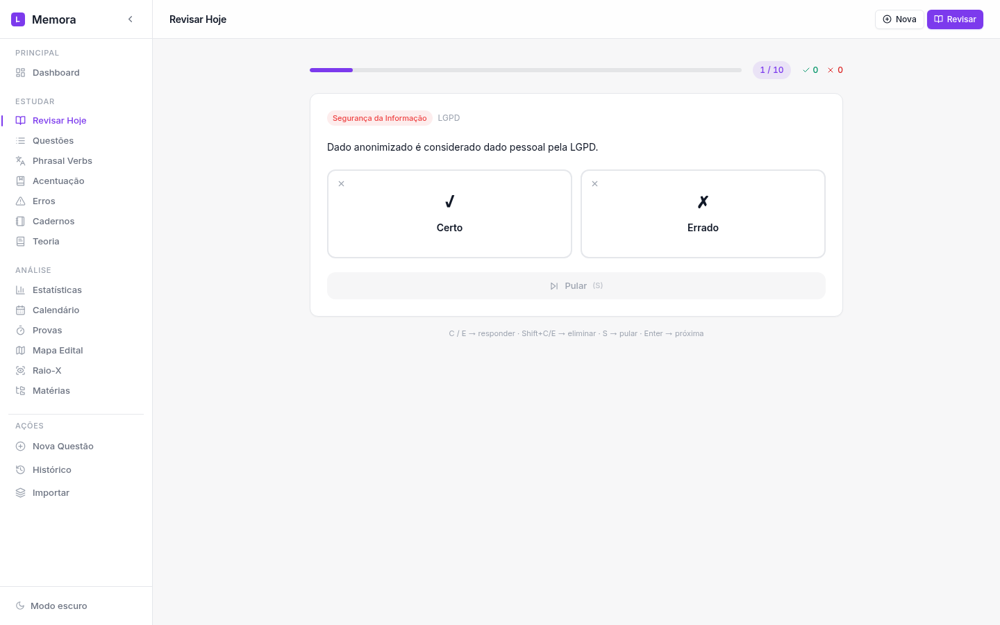
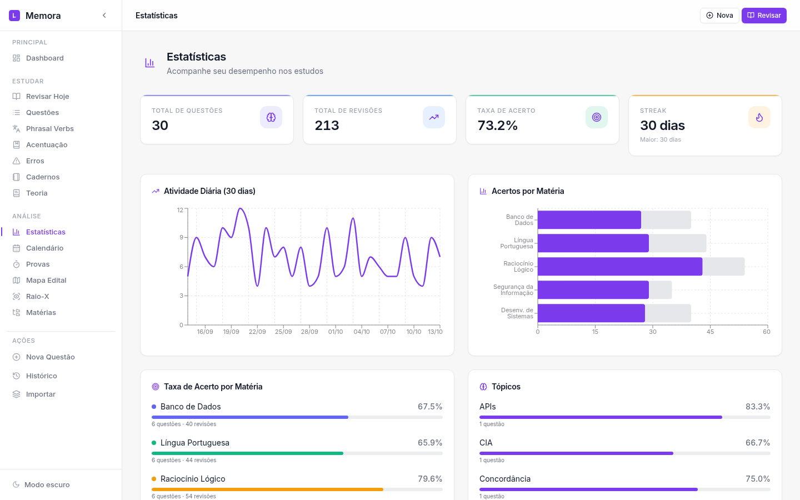
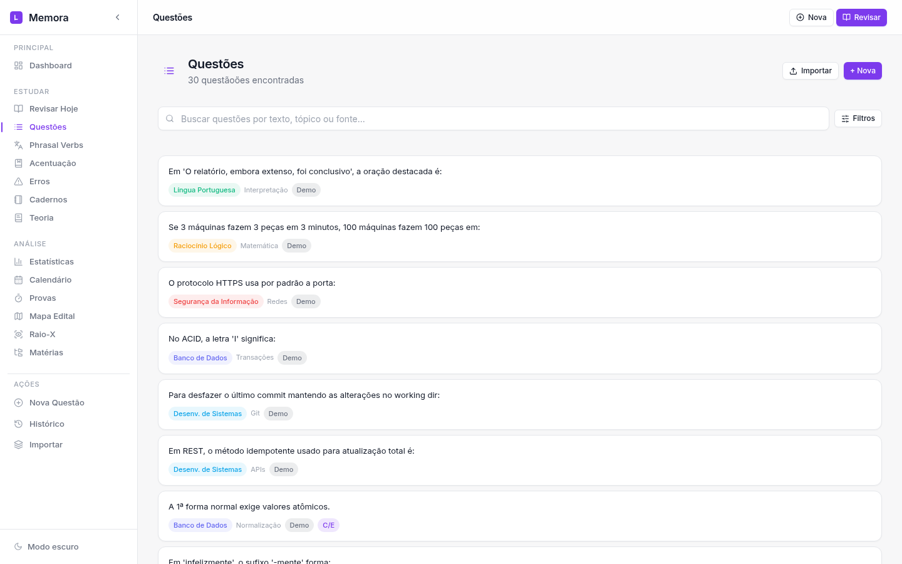

<p align="center">
  
</p>

<h1 align="center">Memora</h1>

<p align="center">
  Plataforma de estudos com repetição espaçada baseada no algoritmo SM-2, projetada para otimizar a retenção de conhecimento. Organize questões, teoria e cadernos, acompanhe suas estatísticas e mantenha uma rotina de revisões diárias para aprender de forma eficiente.
</p>

## Interface

| Dashboard | Revisão | Estatísticas | Questões |
| --------- | ------- | ------------ | -------- |
|  |  |  |  |

## Stack

| Camada     | Tecnologias                                                        |
| ---------- | ------------------------------------------------------------------ |
| Backend    | Laravel 12, PHP 8.4, Eloquent, Redis (cache), DomPDF               |
| Banco      | PostgreSQL 16 (índices compostos, FKs com cascade)                 |
| Frontend   | React 18, TypeScript, Vite, Tailwind 3.4, Recharts, Framer Motion   |
| Infra      | Docker + Compose (api, web/nginx, pgsql, redis), CI GitHub Actions |

## Como rodar

```bash
# subir tudo (api :8080, web :3000)
make up

# parar
make down

# popular com os 200 phrasal verbs + edital
make seed
# ou manual:
# curl -X POST localhost:8080/api/phrasal-verbs/seed
# curl -X POST localhost:8080/api/edital/seed
# (o edital vem de api/database/data/edital.json — arquivo local,
#  fora do git; veja o edital.example.json como modelo)
```

> `APP_KEY` tem um default só para dev local (`docker-compose.yml`).
> Em qualquer ambiente real, exporte `APP_KEY` (ver `.env.example`) —
> nunca suba o default para produção.

Acesse `http://localhost:3000`.

## Testes

```bash
make test   # 18 testes (unit SM-2 + feature da API) sobre Postgres real
```

## Decisões de arquitetura

- **Contrato de API 1:1 com o backend original** (`GET /api/questions`, `POST /api/reviews/:id`, ...) para o frontend não precisar de rewrite.
- **Postgres em vez de SQLite**: índices `(user_id, created_at)`, `(user_id, subject_id)`, FKs com `cascadeOnDelete` (excluir matéria limpa questões, reviews, logs e anotações em transação).
- **Redis**: cache de `GET /api/reviews/today` (5 min), `GET /api/stats/detailed` (5 min) e heatmap anual (1 h), com invalidação no `SubmitReview`.
- **SM-2 isolado em `App\Services\Sm2Service`** com testes unitários — mesma matemática do Anki validada no projeto original.
- **PDF de teoria** via DomPDF com Blade view (antes: gofpdf imperativo).
- **`user_id` nulável em todas as entidades** — prepara autenticação multiusuário (Sanctum/OAuth) sem nova migração destrutiva.
- **Docker**: a imagem PHP instala `pdo_pgsql` + `redis`; o servidor web roda `php -S` direto (sem intermediário) para herdar 100% do env do container — `artisan serve` perde variáveis quando `variables_order` não tem `E`.

## Estrutura

```
memora/
├── api/                    # Laravel 12 (models, controllers, services, tests)
│   ├── app/Models/         # 13 models Eloquent
│   ├── app/Services/Sm2Service.php
│   ├── routes/api.php      # 60 rotas
│   └── tests/              # Unit + Feature (Postgres)
├── web/                    # React SPA (identidade Memora, mobile-first corrigido)
├── docker-compose.yml      # api + web + pgsql + redis
└── Makefile
```

## Endpoints principais

| Método | Rota                              |
| ------ | --------------------------------- |
| GET    | `/api/health`                     |
| CRUD   | `/api/subjects`, `/api/questions` |
| GET    | `/api/reviews/today`              |
| POST   | `/api/reviews/{question}`         |
| GET    | `/api/stats`, `/api/stats/detailed` |
| CRUD   | `/api/theory`, `/api/notebooks`   |
| GET    | `/api/edital/graph`               |
| CRUD   | `/api/exams`, `/api/exam-analyses`|
| GET/POST | `/api/phrasal-verbs...`         |
